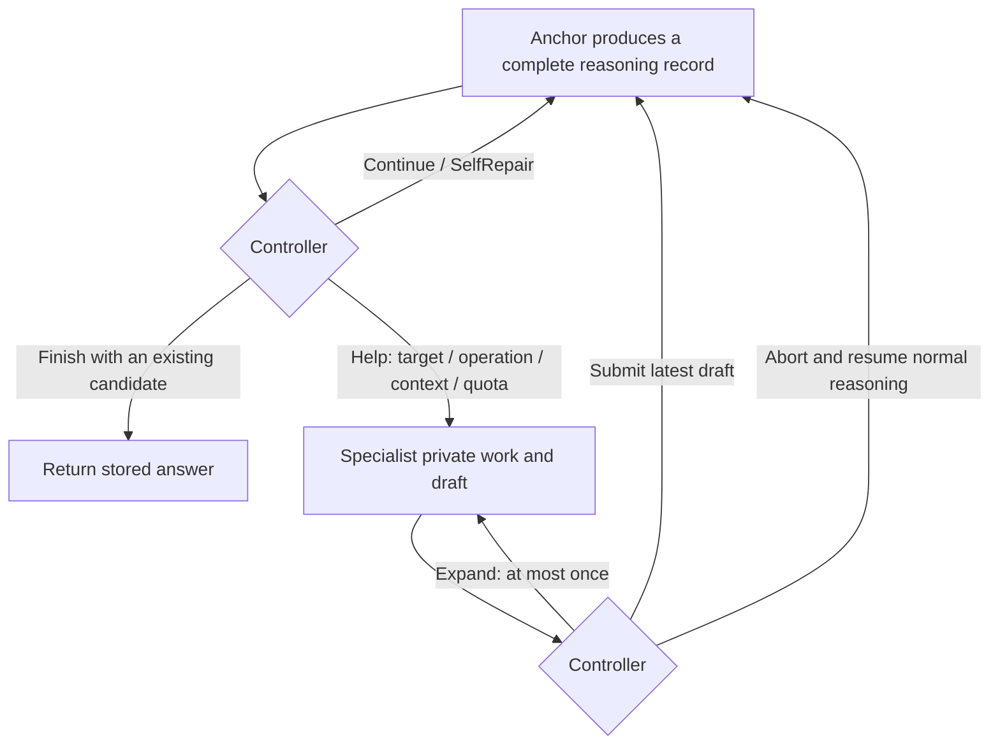

# DARI: Receiver-Driven Local Assistance and Budget Allocation

DARI studies **which local computations to continue, which assistance to deliver, and when to abandon an intervention during reasoning**. This repository implements a local assistance protocol, action values under complete deployment costs, and alternating training driven by the receiver's downstream utility. It includes model interfaces, inference, data collection, controller training, Specialist SFT/DPO, and training orchestration.

This is a research implementation. Synthetic examples validate the software; the repository does not contain pretrained weights or real benchmark results.

## Motivation

Detecting difficulty alone does not determine whether assistance is worthwhile. At the same reasoning state, a model could review its own work, check one step, recompute a subproblem, or finish. Even correct assistance may be irrelevant to the receiver, while additional computation incurs repeated input and latency costs.

DARI treats assistance as a bounded local process. Each Specialist stage produces a deliverable draft that initially remains private. A controller observes existing reasoning activations and chooses whether to submit, extend, or abandon it. Only the Anchor can update the canonical reasoning and final answer.

The proposed research direction is the **joint modeling of assistance content, internal stopping decisions, actual receiver utility, and heterogeneous inference costs**. LoRA, DPO, small value networks, and dynamic routing are established components. Prior work addresses [intervention utility](https://arxiv.org/abs/2606.21399), [hidden-state stopping decisions](https://arxiv.org/abs/2610.30450), and [receiver-utility-oriented communication](https://arxiv.org/abs/2609.37017). Targeted comparisons are needed to establish the contribution of this protocol; these broader concepts should not be claimed as new.

## Modules and Trainable Parameters

| Module | Inputs and architecture | Output | Training |
|---|---|---|---|
| Anchor A | Frozen language model; original task, sources, canonical reasoning, retained evidence, candidate answer, and a temporary draft upon submission | Complete reasoning record | Frozen |
| Specialist Sφ | Frozen language model with LoRA; local context, operation, quota, and private history of the current intervention | Private work and latest draft | LoRA φ only |
| Controller Cθ | A/S projections to 256 dimensions; two Transformer blocks, four heads, FFN width 512; action MLP and reward/cost heads | Values of legal actions | θ, including projections |
| Runtime | Deterministic context assembly, validation, action masks, budgeting, and transitions | Canonical state and cost ledger | Fixed rules |

Controller observations contain pooled vectors for the task, up to eight recent Anchor records, a candidate representation or proxy, up to two Specialist stages, and the latest draft, plus numerical budget and stage features. Action encodings include the action type, target, context width, output quota, known input length, and estimated cost.

There is no separate Probe/Judge LLM. The controller reuses activations from generation instead of running another language-model encoding pass. Pooling is lossy: the observation is not assumed to be Markov, and changing backbones can require retraining.

## Inference Protocol



### Anchor records

```json
{"step":"New reasoning content","refs":["p1","s2"],"goal":"Current subproblem","answer":null}
```

`goal` is a string or JSON `null`; `answer` is a complete answer string or `null`. The host assigns step IDs `s1, s2, ...` and goal IDs `g1, g2, ...`. Records may reference at most four existing IDs; unknown references are filtered. A complete JSON record defines a checkpoint, rather than an arbitrary token boundary. One formatting retry is allowed and charged.

Anchor-side actions:

- **Continue:** advance normal reasoning.
- **SelfRepair:** advance using a fixed review instruction.
- **Help:** select the latest step or current goal, `check/recompute`, `narrow/wide`, and `short/oneshot`. There are at most 16 assistance candidates; only the selected candidate invokes a language model online.
- **Finish:** return the stored candidate when one exists, without another formatting call.

Execution terminates at the reasoning-step, decision, or budget limit. If no candidate exists, the answer remains `null`. Protocol validity does not establish answer correctness.

### Local assistance

```json
{
  "work":"Private analysis for this intervention",
  "draft":{
    "target":"s1",
    "finding":"An identified issue or local conclusion",
    "support":"Source evidence or a checkable derivation",
    "change":"A suggested change for the Anchor",
    "unresolved":"Remaining uncertainty, or an empty string"
  }
}
```

A `short` intervention allows up to 160 output tokens initially and one extension of up to 320 tokens. A `oneshot` intervention allows up to 480 tokens without extension. Each draft is capped at 160 tokens. JSON syntax, private work, and the draft all count toward the stage quota.

The context packet preserves the original task, the target, and direct references of its owning record. A `wide` packet also includes the four most recent canonical records and their direct references. IDs are deduplicated. There is no generative summarizer or guarantee of semantic sufficiency. Assistance actions exceeding the input limit are masked instead of silently truncating task constraints.

- **Submit:** present the latest draft as fallible temporary assistance to the next Anchor step. Its original content is retained for future prompts only if the Anchor references its help ID `hN`.
- **Abort:** clear the intervention and its controller vectors, then advance the Anchor normally. Incurred costs are retained.
- **Expand:** continue the private history and revise the draft; available only after a valid initial short-stage draft.

Both Submit and Abort can invoke the Anchor and are charged. Private work and earlier drafts do not enter Anchor prompts. Audit traces may retain them but are not fed back into subsequent prompts.

## Costs and Action Values

**Tokens from different models must not be summed and treated as compute.** The ledger records input, cached input, output, and call counts per model, then converts each call through a model/deployment-specific cost function into compatible resource units:

\[
K=\sum_j\kappa_{m_j,d_j}(n_j^{in}-n_j^{cache},n_j^{cache},n_j^{out},\ell_j)+K_{controller}.
\]

`ModelProfile` supports uncached input, cached input, output, fixed call overhead, a quadratic prefill term, and a decoding-context term. API deployments can use their pricing; local GPU costs require empirical calibration rather than parameter-count ratios. `Usage.observed_cost` can override an estimate when accompanied by a compatible unit.

A ledger cannot mix dollars with GPU-ms, or real profiles with synthetic ones. Cached input is a subset of total input and is not double-counted. Invalid, abandoned, and retried calls are charged. The local adapter uses configured cost curves; it does not equate wall-clock time with GPU resource cost.

The coefficients in `configs/local.example.json` are placeholders. `calibration_confirmed=false` blocks real inference. Set it to `true` only after supplying measured coefficients and provenance; the flag is a researcher assertion, not an automatic calibration result.

Model curves should cover generation and pooling. `policy_overhead` separately accounts for controller costs in the same resource unit. A CPU controller may consume zero GPU resources, but its CPU latency still needs reporting. Without declared policy overhead, inference reports `cost_complete=false`, and formal data collection rejects incomplete future-cost labels.

`e2e_ms` includes the initial Anchor call, context assembly, controller, and subsequent calls after models are loaded; loading time is excluded. Report CPU time, peak memory, and wall-clock latency separately. Budget masks use estimates and do not guarantee a strict bound on actual execution time.

The controller predicts terminal reward and normalized future cost:

\[
Q_\theta(o,a)=\widehat{\mathbb E}[R_{final}\mid o,a]
-\lambda\widehat{\mathbb E}[K_{future}/K_{ref}\mid o,a].
\]

Future cost covers the selected action and all subsequent A/S calls, repeated inputs, abandoned assistance, formatting retries, and future controller decisions. Past costs are sunk; the shared cost of the current action-selection operation is paid when that operation runs. Changes to prices, deployment, or λ can require recollection and retraining.

## Training Objectives and Alternation

### Controller θ

Freeze the current Specialist and downstream policy. From the same prefix, force alternative legal actions and execute their continuations to termination. Repeated rollouts estimate terminal reward, normalized future cost, and variability. Train the two heads with Huber regression:

\[
\mathcal L_C=\operatorname{Huber}(\hat r,\bar R)
+\eta_C\operatorname{Huber}(\hat k,\bar K_{future}/K_{ref}).
\]

Records include prefix and frozen-snapshot fingerprints, deployment identities for models/tokenizers/templates/representations/adapters, cost units, and normalization scales. The trainer rejects mixed snapshots, deployments, scales, or incomplete cost labels. Offline prefix-reconstruction expenses are training costs and are not added again to the hypothetical online future-cost target.

### Specialist φ

First perform protocol SFT on valid local assistance. Then sample stage outputs under **the same input, target, context, private history, and quota**. Evaluate each through actual downstream execution with the frozen controller and Anchor:

\[
U(y)=\mathbb E[R_{final}-\lambda K_{future}/K_{ref}].
\]

Preference pairs require a utility gap exceeding both the configured threshold and sampling uncertainty. Repeated evaluations replay the sampled output instead of drawing a different intervention. Optimize [DPO](https://arxiv.org/abs/2305.18290) with auxiliary SFT:

\[
\mathcal L_S=-\log\sigma\left(\beta\left[
\log\frac{\pi_\phi(y^+|x)}{\pi_{ref}(y^+|x)}-
\log\frac{\pi_\phi(y^-|x)}{\pi_{ref}(y^-|x)}\right]\right)
+\eta_S\mathcal L_{SFT}.
\]

The reference policy remains the protocol-SFT snapshot. The implementation computes fixed reference log probabilities using a reference adapter on the frozen base, then loads the trainable policy adapter, avoiding a second copy of the large base model. Prompt and padding tokens are masked from the response loss; EOS participates. Training sequences exceeding the length limit are rejected.

An optional early-reception probe compares forced Submit against Abort. It only produces positive-gain auxiliary SFT examples and **does not replace main-policy return labels**. Otherwise, chosen preference responses provide SFT regularization. Draft quality is not required to improve monotonically, and gradients do not pass through sampled Anchor/controller execution.

### Alternating schedule

1. Train or load a protocol-SFT adapter and fix the reference snapshot.
2. Freeze current φ and the downstream control policy; collect action branches and update θ.
3. Freeze the updated θ and Anchor; collect receiver-utility preferences and update φ with DPO + SFT.
4. Recollect next round instead of reusing controller labels from an older φ.
5. After the final φ update, recollect and train the final θ before exporting the deployment pair.

This is approximate policy evaluation/improvement, without guarantees of unbiased DPO, convergence, or monotonic performance. Gold labels enter offline evaluators only, never `Task`, online prompts, or controller observations.

Collection reports include all actual model calls and declared policy overhead, including discarded samples. Reference forwards and gradient optimization are timed separately. Synthetic records remain marked `synthetic=true` and are not empirical efficiency evidence.

## Installation and Download-Free Checks

Requires Python 3.10+. Use an isolated environment and install the appropriate PyTorch build first:

```bash
python -m pip install -e .
python -m unittest discover -s tests -v
python -m dari.demo --expand --output outputs/demo --collect outputs/targets.jsonl
python -m dari.train_controller --data outputs/targets.jsonl --output outputs/controller.pt --steps 20
python -m dari.run --config configs/synthetic.json --tasks examples/tasks.jsonl --output outputs/toy.jsonl --evaluate
```

Example model outputs, tokenization, hidden vectors, and rates are synthetic fixtures. Tests also use small PyTorch causal models to exercise actual gradient updates, frozen bases/references, and alternating-training artifacts.

The initial validation used Python 3.12.2 and PyTorch 2.7.1 CPU, with all 52 tests passing. Two tests used Transformers 4.57.6, PEFT 0.21.3, Accelerate 1.15.0, and Tokenizers 0.22.2 with locally initialized tiny Qwen2 weights to verify forward execution, SFT, fixed-reference DPO, and adapter saving/reloading without downloading pretrained weights. Those tests are skipped when optional model dependencies are absent. Real 32B execution, CUDA/QLoRA memory use, and official benchmark performance require validation in the experimental environment.

## Model Interfaces

Optional local-model dependencies:

```bash
python -m pip install -e ".[models]"
# For CUDA QLoRA:
python -m pip install -e ".[models,qlora]"
```

Copy and complete `configs/local.example.json`: specify model paths/fixed revisions, independent A/S instances, hidden dimensions, and cost profiles. Hub models record the resolved commit. Local weights without a Hub commit require an immutable `deployment_revision`. `device_map=auto` is for inference only. The Specialist trainer uses one process and one device, optionally QLoRA; DDP/FSDP is not implemented. Test whether the target GPU can accommodate 32B models and long inputs.

`HuggingFaceBackend` counts inputs using the model's [chat template](https://huggingface.co/docs/transformers/chat_templating), pools source spans from final-layer activations in normal forwards, and generates with within-call KV caching. It does not retain KV across calls, share it across models/adapters, or run extra state-encoding forwards. At the length cap, the final emitted token has not been fed back and is excluded from output pooling. Returning hidden layers increases memory use and should be included in deployment calibration.

Other inference frameworks can use a factory:

```json
{"backend":{"type":"factory","entrypoint":"your_package.backend:create_backend"}}
```

The factory signature is `create_backend(full_config: dict) -> Backend`. The protocol is defined in `dari/backends.py`:

```python
class Backend:
    synthetic: bool
    deployment_identity: dict
    def count_tokens(self, model_id: str, text: str) -> int: ...
    def count_text_tokens(self, model_id: str, text: str) -> int: ...
    def generate(self, request: GenerationRequest) -> Generation: ...
```

- `count_tokens` includes the actual chat template; `count_text_tokens` counts raw payload text.
- `Generation` returns full text, actual `Usage`, and existing-forward `Feature(source, values)` vectors. `feature_texts` names input spans; `feature_spans` gives ID-specific character ranges recorded during prompt assembly. First-substring matching is not an adequate substitute. Output features use `output` and, when available, `draft`.
- `deployment_identity` must identify the backbone/revision, tokenizer, chat template, representation algorithm, and sampling settings. Its `adapters` mapping associates model IDs with loaded-adapter fingerprints. Manually constructed `ModelHandle` objects also require explicit identities; matching hidden dimensions alone is insufficient.
- Requests contain `seed/role/call_index`. Adapters must freeze parameters, isolate or restore randomness and service state, support same-prefix replay, and avoid implicit cross-branch KV retention.
- Billed invalid outputs must still return usage. Remote failures with unknown usage should stop collection for cost reconciliation rather than being treated as free calls.
- `model_adapters[model_id]` supplies the adapter path after alternating updates; custom factories must load it correctly. Model, template, or projection changes require corresponding training and calibration.

Ordinary closed text APIs do not expose the required hidden states. Random/hash vectors cannot replace them. Such integrations require a separately designed, trained, and accounted observation representation.

## Data and Training Commands

Task JSONL:

```json
{"task_id":"unique-id","question":"Original task and required constraints","sources":{"p1":"Original source"},"gold":"Offline answer","metric":"exact"}
```

Gold is optional for inference. Built-in `exact/choice/f1` scorers are generic, not complete official MATH, HotpotQA, or HumanEval+ implementations. `metric` can instead be `your_package.scoring:make_evaluator`, returning an object with `score(answer, gold) -> [0,1]`. Code-execution benchmarks require an externally isolated official evaluator.

Specialist SFT JSONL contains `schema_version=1, input_id, prompt, response, synthetic`; DPO replaces `response` with `chosen, rejected`. Receiver-utility collection also records snapshots, deployment, cost scale, target, and quota. Different prompts cannot share an input ID. `examples/protocol_sft.jsonl` is a synthetic format example; replace it with protocol data covering actual targets, context widths, and assistance stages.

```bash
# Protocol SFT
python -m dari.train_specialist --mode sft --model-config configs/specialist.example.json --data data/protocol_sft.jsonl --output outputs/sft_adapter --steps 100 --max-length 8672 --load-in-4bit

# Collect controller labels and train theta
python -m dari.collect --config configs/local.json --tasks data/train.jsonl --mode controller --adapter outputs/sft_adapter --output outputs/theta_data
python -m dari.train_controller --data outputs/theta_data/targets.jsonl --output outputs/theta.pt --steps 1000 --lambda-cost 0.1

# Collect receiver preferences and train phi
python -m dari.collect --config configs/local.json --tasks data/train.jsonl --mode specialist --controller outputs/theta.pt --adapter outputs/sft_adapter --output outputs/phi_data
python -m dari.train_specialist --mode dpo --model-config configs/specialist.example.json --data outputs/phi_data/preferences.jsonl --init-adapter outputs/sft_adapter --reference-adapter outputs/sft_adapter --output outputs/dpo_adapter --max-length 8672 --load-in-4bit

# Full alternating training
python -m dari.alternate --config configs/local.json --output outputs/training

# Inference with the final exported theta/phi pair
python -m dari.run --config outputs/training/deployment.json --tasks data/test.jsonl --output outputs/predictions.jsonl --evaluate
```

Run commands from the project root; relative paths resolve against the current working directory. `max-length` covers input plus response and should accommodate the permitted input/output while remaining within the model context limit. Controller configuration, λ, and cost scales must agree.

If reliable preference pairs are unavailable, alternating training saves the collected data and stops explicitly. Inspect coverage and receiver behavior rather than recording a successful update. Each round saves data, controller, adapter, and manifests; the final export includes `deployment.json`.

Controller `--resume` warm-starts parameters with a new optimizer; exact optimizer/RNG restoration is not promised. Normal inference strictly checks model and adapter identity. Alternation explicitly permits Specialist adapter updates only when the base/template/cost deployment stays compatible. For manual refresh steps, use `--allow-specialist-update`; it does not permit other deployment differences. Load only trusted models and checkpoints.

## Code Guide

| File | Responsibility |
|---|---|
| `dari/backends.py` | Model protocol, requests/results, synthetic backend |
| `dari/hf_backend.py` | Local model loading, chat inputs, KV generation, activation pooling |
| `dari/schema.py` | Tasks, canonical records, drafts, actions, features |
| `dari/context.py` | Original-source packets and Anchor prompts |
| `dari/runtime.py` | Budget masks, validation, transitions, replay |
| `dari/costs.py` | Per-model tokens and compatible-unit accounting |
| `dari/controller.py` | Theta network, state/action encoding, inference policy |
| `dari/training.py` | Regression/SFT/DPO losses and minimal ordinary-Linear LoRA |
| `dari/collection.py` | Same-prefix controller labels, serialization, provenance |
| `dari/receiver_collection.py` | Specialist replay, receiver utility, auxiliary early probes |
| `dari/specialist_data.py` | SFT/DPO JSONL and response masks |
| `dari/configuration.py` | Factories, offline-label separation, policy loading |
| `dari/identity.py` | Model, adapter, and policy artifact fingerprints |
| `dari/evaluation.py` | Generic scoring and official-evaluator boundary |
| `dari/workflows.py` | Bounded collection phases and snapshots |
| `dari/train_controller.py` | Controller minibatch optimization and checkpoints |
| `dari/train_specialist.py` | PEFT LoRA/QLoRA SFT and DPO + SFT |
| `dari/alternate.py` | Alternating schedule and final controller refresh |
| `dari/collect.py`, `dari/run.py` | Collection and inference commands |
| `dari/demo.py`, `dari/defaults.json` | Download-free protocol demonstration |
| `configs/`, `examples/` | Configuration templates and synthetic data |
| `tests/` | Protocol, cost, model-boundary, gradient, replay, and alternation checks |

Real-model training uses [PEFT](https://huggingface.co/docs/peft/package_reference/peft_model) [LoRA](https://arxiv.org/abs/2106.09685). The minimal LoRA in `training.py` supports ordinary Linear layers and basic tests; it is not interchangeable with PEFT checkpoints.

Generated predictions, training data, weights, build caches, and process documents are excluded from source delivery. Real weights, official benchmark adapters, and large-scale results belong to subsequent experiments.
