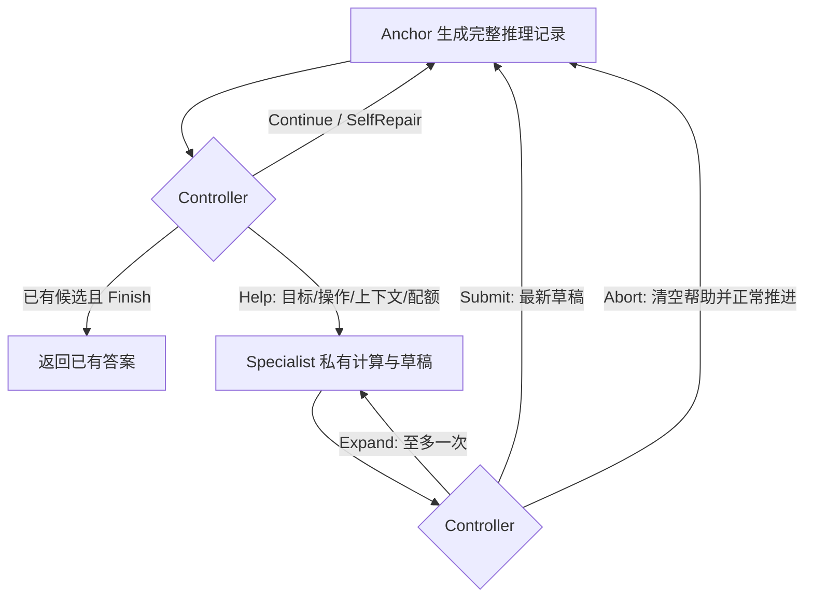

# DARI：接收收益驱动的局部帮助与预算分配

DARI 研究：**主推理需要帮助时，什么局部计算值得继续，什么内容值得交付，什么时候应该放弃？** 本项目实现局部帮助协议、完整部署成本下的动作价值、接收收益驱动的交替训练，包含模型接口、推理、数据采集、控制器训练、Specialist SFT/DPO 和交替调度。

这是研究实现。合成示例用于检查代码；仓库不包含真实基准结果、预训练模型权重。

## 方法立意

识别困难并不能直接回答是否值得求助。同一状态可以自行复查、检查某一步、重算一个子问题或直接结束。帮助即使正确，也可能与接收者无关；继续计算还会带来重复输入和等待。

DARI 将帮助组织成有预算的局部过程。Specialist 每段都产生可交付草稿，草稿先留在私有工作区。控制器观察现有推理激活，决定提交、追加计算或放弃；只有 Anchor 可以改写正式推理和最终答案。

候选研究贡献是**帮助内容、内部停止决策、实际接收收益和异构成本的联合建模**。LoRA、DPO、小型价值网络或动态路由本身不是新贡献。已有工作研究了[干预收益](https://arxiv.org/abs/2606.21399)、[隐藏状态停止决策](https://arxiv.org/abs/2610.30450)和[接收者效用导向的通信](https://arxiv.org/abs/2609.37017)；论文需要用针对性对比证明本协议的增益，不宜声称这些概念首次出现。

## 运行模块与训练范围

| 模块 | 输入与结构 | 输出 | 训练范围 |
|---|---|---|---|
| Anchor A | 冻结语言模型；原题、来源、正式推理、保留证据、候选答案；提交时加入临时草稿 | 完整推理记录 | 冻结 |
| Specialist Sφ | 冻结语言模型 + LoRA；局部上下文、操作、配额和本次帮助私有历史 | 私有分析与最新草稿 | LoRA φ |
| Controller Cθ | A/S 投影到 256 维；两层 Transformer、4 头、FFN 512；动作 MLP、收益/成本头 | 合法动作价值 | θ，包括投影层 |
| Runtime | 确定性组包、协议校验、动作掩码、预算与状态转换 | 正式状态与账本 | 固定规则 |

控制器观察任务、最近最多 8 条 Anchor 记录、候选代理、最多两段 Specialist 输出和最新草稿的池化向量，以及预算/阶段等数值特征。动作编码包含类型、目标、上下文宽度、配额、已知输入长度和成本。

没有独立的 Probe/Judge LLM。控制器复用生成时已有激活，不额外调用语言模型编码状态。池化是有损观察，不假设它满足马尔可夫性，也不保证无需训练就能更换骨干。

## 完整推理流程



### Anchor 协议

```json
{"step":"新增推理内容","refs":["p1","s2"],"goal":"当前子问题","answer":null}
```

`goal` 是字符串或 JSON `null`，`answer` 是完整答案字符串或 `null`。Host 分配步骤 ID `s1, s2, ...` 和目标 ID `g1, g2, ...`。最多引用 4 个已有 ID，未知引用被过滤。只有完整 JSON 形成检查点，不在任意 token 位置截断推理。格式错误最多重试一次，重试计费。

Anchor 侧动作：

- **Continue**：正常推进。
- **SelfRepair**：使用固定复查指令推进。
- **Help**：选择最近推理/当前目标、`check/recompute`、`narrow/wide`、`short/oneshot`，最多 16 个帮助候选；在线只执行选中的候选。
- **Finish**：仅在已有合法候选时可用，直接返回已保存答案，没有额外格式化调用。

达到步数、决策数或预算限制时终止；没有候选则返回 `null`。协议合法性不等于答案正确性。

### 局部帮助协议

```json
{
  "work":"仅在本次帮助内可见的分析",
  "draft":{
    "target":"s1",
    "finding":"发现的问题或局部结论",
    "support":"原文依据或可检查的推导",
    "change":"建议 Anchor 如何修改",
    "unresolved":"尚未解决的问题；没有则为空字符串"
  }
}
```

`short` 首段最多 160 输出 token，可扩展一次、最多 320 token；`oneshot` 一次最多 480 token，不能扩展。每份草稿最多 160 token。JSON、私有分析和草稿均包含在阶段总配额内。

上下文包保留原题，加入目标及所属记录的直接引用；`wide` 再加入最近 4 条正式记录及其直接引用。相同 ID 去重，没有生成式摘要，也不保证选中的上下文在语义上充分。超过输入上限的帮助动作被屏蔽，不悄悄截断原题约束。

- **Submit**：最新草稿作为可质疑的临时帮助，由 Anchor 下一步处理。Anchor 引用帮助 ID `hN` 才保留原始草稿供后续使用。
- **Abort**：清除本次帮助和控制器帮助向量，再正常推进 Anchor。已花费成本不退还。
- **Expand**：仅首段短帮助存在合法完整草稿时可用；继续私有历史并更新草稿。

Submit 和 Abort 都可能触发 Anchor 调用，均计费。私有分析和旧草稿不进入 Anchor 提示。审计 trace 可以保留它们，但不会回灌到模型输入。

## 成本与动作价值

**不同模型的 token 不能直接相加作为计算量。** 账本分别保存各模型的输入、缓存输入、输出和调用次数，再按模型/部署的成本函数换算到兼容的资源单位：

\[
K=\sum_j\kappa_{m_j,d_j}(n_j^{in}-n_j^{cache},n_j^{cache},n_j^{out},\ell_j)+K_{controller}.
\]

`ModelProfile` 支持未缓存输入、缓存输入、输出、固定调用、预填充平方项和解码上下文项。API 可用部署价格；本地 GPU 成本需要实测拟合，不能仅按参数量比例换算。`Usage.observed_cost` 可覆盖估计值，但必须给出兼容单位。

同一账本禁止混合美元/GPU-ms 或真实/合成配置。缓存输入是总输入的子集，不重复收费。无效、被放弃和重试的调用均计费。本地适配器默认使用配置的成本曲线，不会自动把墙钟时间冒充 GPU 成本。

`configs/local.example.json` 的系数是占位符，`calibration_confirmed=false` 会阻止真实运行。填写实测系数和出处后才能改为 `true`；该标志是研究者确认，不是自动标定结果。

模型曲线应覆盖生成与池化；控制器通过 `policy_overhead` 单独计入同单位资源成本。CPU 控制器的 GPU 资源成本可以为 0，但 CPU 延迟仍需报告。没有提供策略开销时，推理标记 `cost_complete=false`，正式训练数据采集拒绝遗漏开销的标签。

`e2e_ms` 包含模型已载入后的首次 Anchor 调用、组包、控制器和后续调用，不含模型加载。CPU 时间、峰值内存和墙钟延迟应分别报告。预算掩码基于成本估计，不能保证实际运行时间绝不超限。

控制器学习收益与归一化未来成本：

\[
Q_\theta(o,a)=\widehat{\mathbb E}[R_{final}\mid o,a]
-\lambda\widehat{\mathbb E}[K_{future}/K_{ref}\mid o,a].
\]

未来成本包含选中动作及后续全部 A/S 调用、重复输入、放弃的帮助、格式重试和未来控制决策。过去支出是沉没成本；当前动作选择本身的共同开销在实际选择时支付。改变价格、部署或 λ 后应相应重新收集/训练，不能假定旧策略仍最优。

## 训练目标与交替流程

### 控制器 θ

冻结当前 Specialist 和下游策略，在同一前缀分别强制执行合法动作并实际运行到结束。重复采样得到终局奖励、归一化未来成本和方差，以 Huber 回归两个头：

\[
\mathcal L_C=\operatorname{Huber}(\hat r,\bar R)
+\eta_C\operatorname{Huber}(\hat k,\bar K_{future}/K_{ref}).
\]

数据保存前缀指纹、冻结快照、模型/tokenizer/模板/表示与 adapter 的部署指纹、成本单位和归一化尺度；训练器拒绝混合快照/部署/尺度及不完整成本标签。离线恢复前缀的额外费用属于训练成本，不重复计入假设中的在线动作未来成本。

### Specialist φ

先进行合法局部帮助的协议 SFT，再对**相同输入、目标、上下文、私有历史和配额**采样多个阶段输出。每个输出通过冻结控制器与 Anchor 的真实后续执行获得效用：

\[
U(y)=\mathbb E[R_{final}-\lambda K_{future}/K_{ref}].
\]

效用差超过阈值及采样不确定性时才形成偏好对。重复评估同一候选时，重放已采样输出，不重新抽取另一段帮助。采用 [DPO](https://arxiv.org/abs/2305.18290) 加辅助 SFT：

\[
\mathcal L_S=-\log\sigma\left(\beta\left[
\log\frac{\pi_\phi(y^+|x)}{\pi_{ref}(y^+|x)}-
\log\frac{\pi_\phi(y^-|x)}{\pi_{ref}(y^-|x)}\right]\right)
+\eta_S\mathcal L_{SFT}.
\]

参考策略固定为协议 SFT 快照。代码先在同一冻结基座上用参考 adapter 计算固定 log-prob，再加载可训练 policy adapter，避免复制第二份大基座。提示词/padding 不参与响应损失，EOS 参与；超过训练序列上限直接报错。

可选早期接收测试比较强制 Submit 与 Abort 的后续收益，只产生有正收益的辅助 SFT 样本，**不替换主策略回报标签**。没有这类样本时，用偏好中的 chosen 作 SFT 正则。没有要求草稿逐段单调改善，也不通过 Anchor/控制器采样传播梯度。

### 交替调度

1. 协议 SFT 或载入已有 SFT adapter；固定参考快照。
2. 固定当前 φ 和下游控制策略，采集动作分支并更新 θ。
3. 固定更新后的 θ 与 Anchor，采集接收效用偏好，以 DPO + SFT 更新 φ。
4. 下一轮重新采集，不复用旧 φ 的控制器标签。
5. 最后一次 φ 更新后，再采集并训练最终 θ，导出二者的部署配置。

这是近似策略评估/改进，不保证 DPO 无偏、交替收敛或性能单调改善。Gold 只传给离线 evaluator，不进入 `Task`、在线提示或控制器观察。

采集报告统计所有实际模型调用和配置的策略开销，包括丢弃候选；参考前向和梯度优化另报告时间。合成记录始终带 `synthetic=true`，不能作为论文效率证据。

## 安装与无需下载模型的检查

Python 3.10+；建议独立环境。安装适合本机的 PyTorch 后执行：

```bash
python -m pip install -e .
python -m unittest discover -s tests -v
python -m dari.demo --expand --output outputs/demo --collect outputs/targets.jsonl
python -m dari.train_controller --data outputs/targets.jsonl --output outputs/controller.pt --steps 20
python -m dari.run --config configs/synthetic.json --tasks examples/tasks.jsonl --output outputs/toy.jsonl --evaluate
```

示例中的模型输出、tokenizer、隐藏向量和费率是合成夹具。测试也使用小型 PyTorch 因果模型验证真实梯度更新、基座/参考冻结与交替训练产物。

本次验证环境为 Python 3.12.2 / PyTorch 2.7.1 CPU。全部 52 项测试通过；其中两项使用实际 Transformers 4.57.6、PEFT 0.21.3、Accelerate 1.15.0 和 Tokenizers 0.22.2，在本地随机初始化的小型 Qwen2 上验证前向、SFT、固定参考 DPO、adapter 保存/重载，不下载预训练权重。未安装可选模型依赖时，这两项会跳过。真实 32B、CUDA、QLoRA 显存和官方基准效果仍需在实验环境验证。

## 模型接口

本地模型的可选依赖：

```bash
python -m pip install -e ".[models]"
# CUDA QLoRA 另外安装：
python -m pip install -e ".[models,qlora]"
```

复制并填写 `configs/local.example.json`，设置模型路径/固定 revision、独立的 A/S 模型实例、隐藏维度和成本。Hub 模型记录实际解析的 commit；无 Hub commit 的本地权重必须配置不可变的 `deployment_revision`。`device_map=auto` 仅用于推理；Specialist 训练器是单进程单设备，可选 QLoRA，不包含 DDP/FSDP。32B 和长输入能否容纳，需要在目标 GPU 上实测。

`HuggingFaceBackend` 用模型的 [chat template](https://huggingface.co/docs/transformers/chat_templating) 计算输入长度，在正常前向的最终层激活上池化来源片段，并使用调用内 KV cache 生成。它不跨调用保存 KV，不在模型/adapter 间共享 KV，不额外前向编码状态。长度上限处最后一个未送回模型的 token 不参与输出池化；完整隐藏层返回会增加显存，应纳入部署标定。

其他框架可用工厂接口：

```json
{"backend":{"type":"factory","entrypoint":"your_package.backend:create_backend"}}
```

工厂为 `create_backend(full_config: dict) -> Backend`，协议定义在 `dari/backends.py`：

```python
class Backend:
    synthetic: bool
    deployment_identity: dict
    def count_tokens(self, model_id: str, text: str) -> int: ...
    def count_text_tokens(self, model_id: str, text: str) -> int: ...
    def generate(self, request: GenerationRequest) -> Generation: ...
```

- `count_tokens` 返回包含实际 chat 模板的输入长度；`count_text_tokens` 返回原始载荷长度。
- `Generation` 返回完整文本、实际 `Usage` 和已有前向的 `Feature(source, values)`。`feature_texts` 指定输入片段，`feature_spans` 给出组包时按 ID 记录的原始提示字符范围；不能用第一次子串匹配替代它。输出特征使用 `output` 和可用时的 `draft`。
- `deployment_identity` 必须稳定标识骨干/revision、tokenizer、chat 模板、表示算法与采样设置；其中 `adapters` 是模型 ID 到已载入 adapter 指纹的映射。手工建立 `ModelHandle` 时也须明确提供身份，不能只用维度检查兼容性。
- 请求含 `seed/role/call_index`；适配器须冻结参数，隔离/恢复随机状态和服务状态，支持同前缀重放，不隐式保存跨分支 KV。
- 有费用的无效输出仍须返回 usage。无法确定 usage 的远程失败应中止并核对费用，不能视作免费调用。
- `model_adapters[model_id]` 是交替训练后的 adapter 路径，自定义工厂须正确载入。模型、模板或来源投影改变后需要相应训练与标定。

普通闭源文本 API 不返回所需隐藏状态，不能直接用随机/哈希向量替代。接入它需要另行设计、训练并计费的观察表示；本项目没有隐藏这个限制。

## 数据与训练命令

任务 JSONL：

```json
{"task_id":"unique-id","question":"原题与不可丢失约束","sources":{"p1":"原始来源"},"gold":"离线答案","metric":"exact"}
```

纯推理可不含 gold。内置 `exact/choice/f1` 是通用评分器，不冒充 MATH、HotpotQA、HumanEval+ 官方实现。`metric` 也可填 `your_package.scoring:make_evaluator`，返回 `score(answer, gold) -> [0,1]` 的对象。代码执行基准由外部隔离的官方评测器处理。

Specialist JSONL：SFT 行包含 `schema_version=1, input_id, prompt, response, synthetic`；DPO 行将 `response` 换成 `chosen, rejected`。接收收益采集还写入快照、部署、成本尺度、目标和配额。不同提示不能共用 input ID。`examples/protocol_sft.jsonl` 是合成格式示例，应替换成覆盖实际目标、上下文宽度和帮助阶段的协议数据。

```bash
# 协议 SFT
python -m dari.train_specialist --mode sft --model-config configs/specialist.example.json --data data/protocol_sft.jsonl --output outputs/sft_adapter --steps 100 --max-length 8672 --load-in-4bit

# 采集控制器标签，再训练 θ
python -m dari.collect --config configs/local.json --tasks data/train.jsonl --mode controller --adapter outputs/sft_adapter --output outputs/theta_data
python -m dari.train_controller --data outputs/theta_data/targets.jsonl --output outputs/theta.pt --steps 1000 --lambda-cost 0.1

# 采集接收收益偏好，再训练 φ
python -m dari.collect --config configs/local.json --tasks data/train.jsonl --mode specialist --controller outputs/theta.pt --adapter outputs/sft_adapter --output outputs/phi_data
python -m dari.train_specialist --mode dpo --model-config configs/specialist.example.json --data outputs/phi_data/preferences.jsonl --init-adapter outputs/sft_adapter --reference-adapter outputs/sft_adapter --output outputs/dpo_adapter --max-length 8672 --load-in-4bit

# 完整交替训练
python -m dari.alternate --config configs/local.json --output outputs/training

# 用最终导出的 θ、φ 推理
python -m dari.run --config outputs/training/deployment.json --tasks data/test.jsonl --output outputs/predictions.jsonl --evaluate
```

命令在项目根目录执行，相对路径也相对于当前目录。`max-length` 是输入加响应的训练序列上限，应覆盖允许的输入/输出且小于模型上下文上限。控制器配置、λ 和成本尺度需一致。

没有可靠偏好对时，交替训练保存数据并明确停止，应检查覆盖率与接收者行为，不能记录为成功更新。每轮保存数据、控制器、adapter 和 manifest；最后导出 `deployment.json`。

控制器 `--resume` 是从已有参数继续优化，会重新创建优化器，不承诺中断前的优化器/RNG 精确恢复。普通推理严格检查模型与 adapter 身份；交替训练显式允许在基座/模板/成本不变时跨 Specialist adapter 更新采集和继续训练。手工分步执行这种刷新时，使用 `--allow-specialist-update`，它不放开其他部署差异。只加载可信模型和 checkpoint。

## 代码文件指引

| 文件 | 职责 |
|---|---|
| `dari/backends.py` | 模型接口、请求/返回结构与合成后端 |
| `dari/hf_backend.py` | 本地模型加载、chat 输入、KV 生成、激活池化 |
| `dari/schema.py` | Task、正式记录、草稿、动作和特征 |
| `dari/context.py` | 原文组包与 Anchor 提示 |
| `dari/runtime.py` | 预算掩码、校验、状态转换与重放 |
| `dari/costs.py` | 每模型 token 与兼容单位成本账本 |
| `dari/controller.py` | θ 网络、状态/动作编码与推理策略 |
| `dari/training.py` | 回归/SFT/DPO 损失及小型普通 Linear LoRA |
| `dari/collection.py` | θ 同前缀标签、数据读写和溯源 |
| `dari/receiver_collection.py` | φ 候选重放、接收效用和早期辅助测试 |
| `dari/specialist_data.py` | SFT/DPO JSONL 与响应标签屏蔽 |
| `dari/configuration.py` | 工厂、离线标签分离、策略载入 |
| `dari/identity.py` | 模型、adapter 与策略产物指纹 |
| `dari/evaluation.py` | 通用评分和官方评测接口 |
| `dari/workflows.py` | 有限的数据采集阶段与快照 |
| `dari/train_controller.py` | θ 小批量优化和 checkpoint |
| `dari/train_specialist.py` | PEFT LoRA/QLoRA 的 SFT、DPO+SFT |
| `dari/alternate.py` | 交替调度与最后一次 θ 刷新 |
| `dari/collect.py`, `dari/run.py` | 数据采集与推理命令 |
| `dari/demo.py`, `dari/defaults.json` | 无需下载模型的协议演示 |
| `configs/`, `examples/` | 配置模板与合成数据 |
| `tests/` | 协议、成本、模型边界、梯度、重放和交替测试 |

实际模型训练使用 [PEFT](https://huggingface.co/docs/peft/package_reference/peft_model) 的 [LoRA](https://arxiv.org/abs/2106.09685)。`training.py` 中的小型 LoRA 仅适配普通 Linear 和基础测试，不与 PEFT checkpoint 混用。

生成的预测、训练数据、权重、构建缓存和过程性文档不作为项目源码交付。真实权重、官方基准适配及大规模训练结果由后续实验提供。
